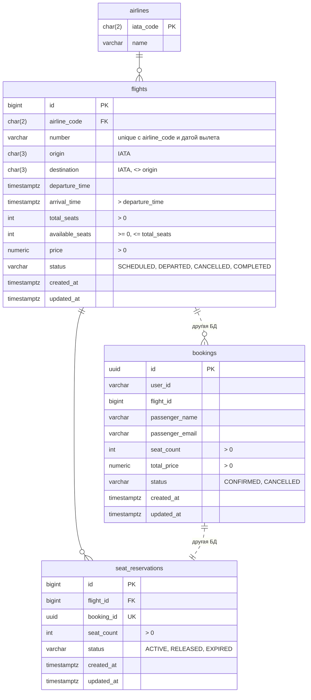

# ER-диаграмма

`airlines`, `flights` и `seat_reservations` лежат в базе Flight Service, `bookings` в базе Booking Service. Поэтому `bookings.flight_id` и `seat_reservations.booking_id` без внешних ключей.

Авиакомпания вынесена в отдельную таблицу, потому что название зависит от кода, а не от рейса. По той же причине номер рейса хранится как код авиакомпании + число (`SU` + `1234`), `SU1234` собирается в запросе. Дата вылета отдельно не хранится, уникальность рейса на дату сделана индексом по `departure_time`.

`available_seats` можно посчитать по активным резервациям, но ТЗ требует хранить это поле. Оно меняется в той же транзакции, что и резервации, так что не расходится. В `bookings` хранится только `total_price`, это цена на момент брони, а не текущая цена рейса.

Все ограничения сделаны через CHECK в миграциях: `flight-service/migrations` и `booking-service/migrations`.
