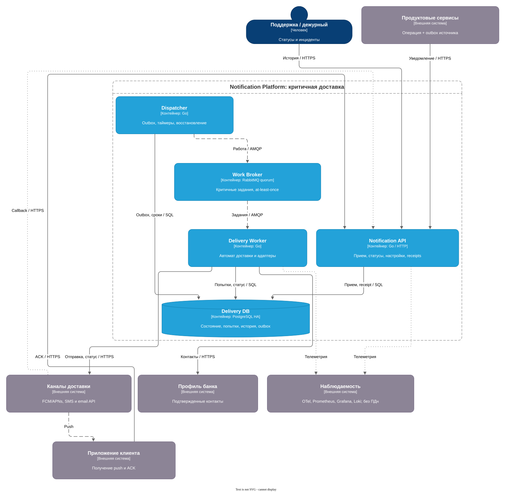
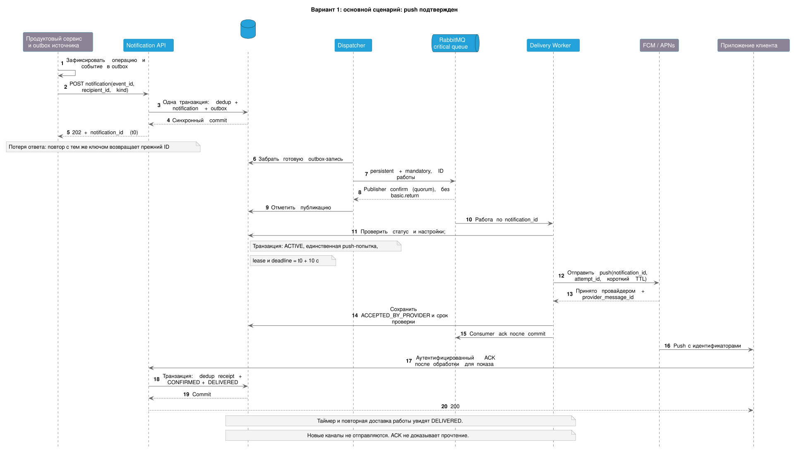
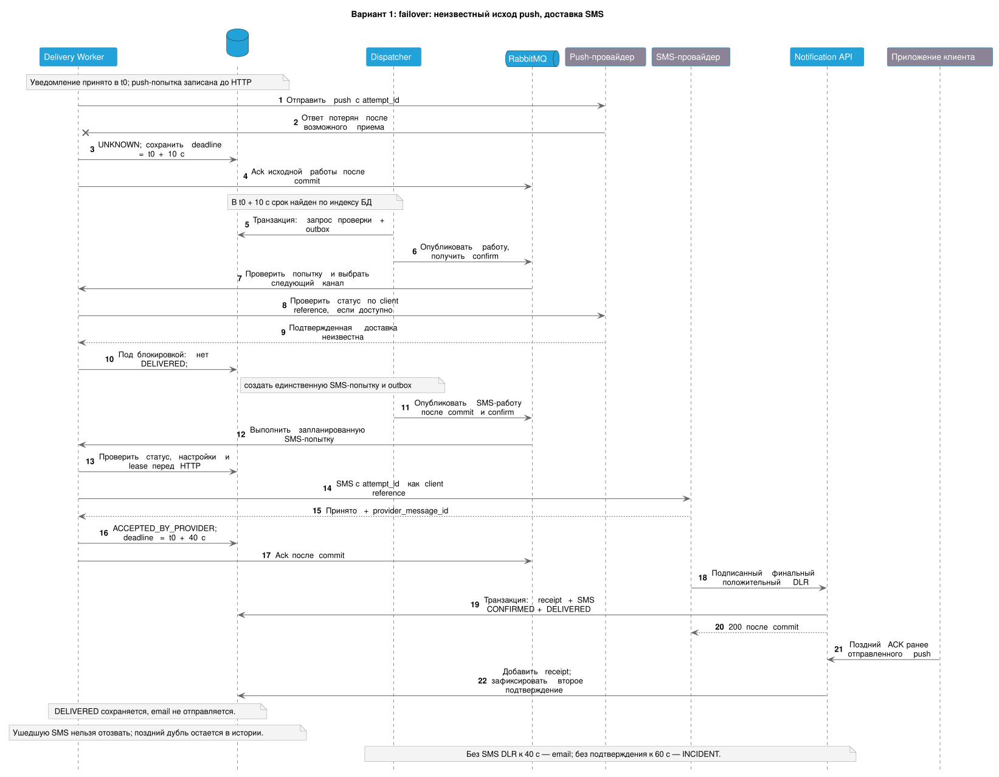
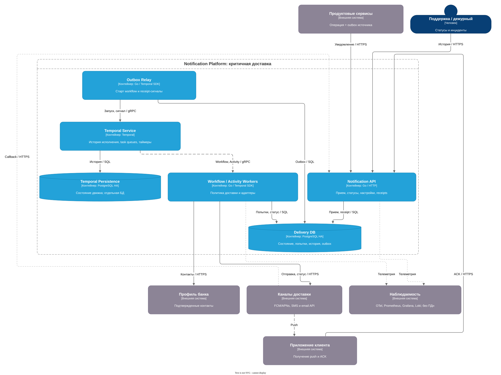
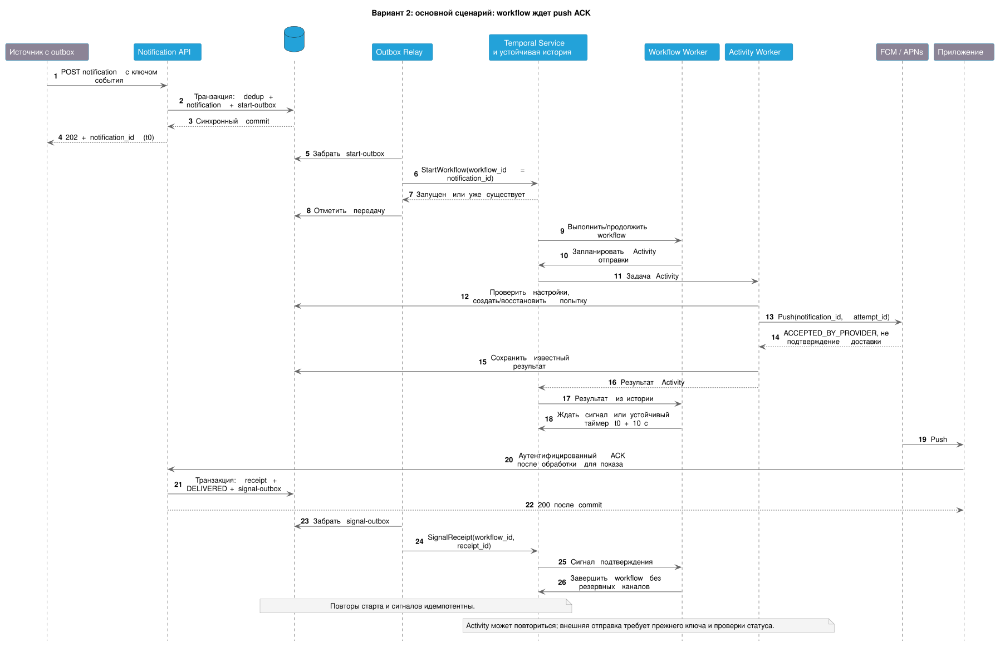
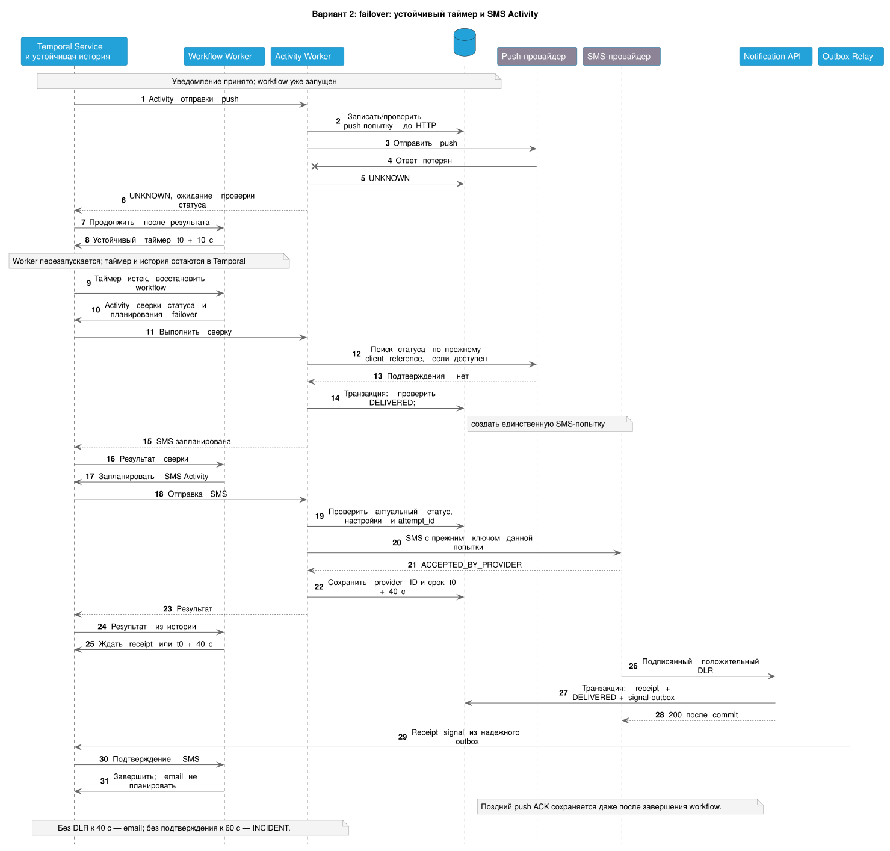

## Оглавление

1. [Контекст](#контекст)
2. [Продуктовый анализ](#продуктовый-анализ)
3. [Пользовательские сценарии](#пользовательские-сценарии)
4. [Статистика](#статистика)
5. [Требования](#требования)
6. [Варианты решения](#варианты-решения)
7. [Сравнительный анализ](#сравнительный-анализ)
8. [Выводы](#выводы)
9. [Связанные задачи](#связанные-задачи)

---

## Контекст

Сейчас каждая команда банка отправляет уведомления сама. Сообщения задерживаются и дублируются, а общего журнала доставки нет. Особенно неприятно это для переводов и списаний: клиент может не узнать об операции, а поддержка не сможет объяснить, куда делось уведомление.

Все сообщения будем принимать через Notification Platform. В этом RFC разбираю доставку критичных уведомлений: как сохранить задание, дождаться подтверждения и переключить канал при неудаче. Кампании рассматриваю только с точки зрения нагрузки на общие ресурсы. Требования и ASR всей платформы находятся в [README](README.md).

### Ключевые вопросы

1. Какую проблему мы решаем? Критичные сообщения задерживаются или теряются при отказе основного канала.
2. Почему это важно сейчас? Через уведомления клиент узнает о движении денег, поэтому сбои затрагивают его безопасность и увеличивают обращения в поддержку.
3. Кто затронут этим изменением? Клиенты получают сообщения, продуктовые команды передают события, поддержка и дежурный разбирают недоставки.

---

## Продуктовый анализ

Надежная доставка должна уменьшить число жалоб на задержки и повторы. Цель банка: снизить жалобы на 30%. Сравниваем число жалоб на 100 тыс. принятых уведомлений с базой за предыдущие четыре недели, отдельно учитываем повторы, задержки и нежелательные сообщения.

Рост retention на 15% считаем относительным. Например, при D30 retention 40% целевое значение будет 46%. Настройки и частоту маркетинга проверяем на контрольной группе. Само внедрение платформы еще не означает, что retention вырастет.

Для критичных сообщений основной показатель: доля уведомлений с подтвержденной доставкой за 60 с. Стоимость на 1 000 доставок считаем отдельно, поскольку запасной SMS-канал заметно дороже push.

---

## Пользовательские сценарии

| Приоритет | Тип сценария | Действующее лицо | Сценарий |
|-----------|--------------|------------------|----------|
| MUST HAVE | Основной | Клиент | После списания получает push. Приложение подтверждает обработку сообщения, дальнейшие каналы не используются. |
| MUST HAVE | Переключение канала | Клиент | Push не подтвержден вовремя. Приходит SMS, при неудаче SMS используется email. |
| MUST HAVE | Настройки | Клиент | Выбирает SMS основным каналом критичных сообщений. Система начинает с SMS, даже если push дешевле. Полностью отключить критичные нельзя. |
| MUST HAVE | Повтор запроса | Продуктовая команда | После потери ответа повторяет передачу события и получает прежний ID уведомления. |
| MUST HAVE | Полный отказ | Дежурный | Получает сигнал о недоставленном сообщении, видит причины и контролирует восстановление отправки. |
| MUST HAVE | Позднее подтверждение | Поддержка | ACK push приходит после отправки SMS. Обе попытки остаются в одной истории, новых отправок нет. |
| SHOULD HAVE | Стоимость | Команда коммуникаций | Видит долю SMS и стоимость доставки, проверяет влияние изменений маршрута на задержку. |

MUST HAVE обязательно для запуска, SHOULD HAVE можно закончить после проверки основного механизма доставки.

---

## Статистика

По условию MAU составляет 10 млн, DAU 3 млн, одновременно активны до 300 тыс. пользователей. На пользователя в день приходится 2 транзакционных, 3 сервисных и 5 маркетинговых уведомлений. Кампания может охватывать до 1 млн адресатов.

В расчетах применяю частоты к DAU. Пять маркетинговых сообщений считаю входными кандидатами: согласия, тихие часы и ограничение частоты сократят число отправок. Если в задании имеются в виду частоты на MAU, нагрузка вырастет до 100 млн в сутки; это отдельный сценарий для проверки.

---

## Требования

### Функциональные требования

Использую обозначения из README. Здесь уточняю их для критичной доставки.

| № | Приоритет | Обозначение | Требование |
|---|-----------|-------------|------------|
| 1 | MUST HAVE | FR1 | Продуктовая команда передает событие через платформу, получает ID и может узнать состояние доставки. |
| 2 | MUST HAVE | FR2 | При отказе или отсутствии подтверждения система автоматически пробует следующий доступный канал. Без подтверждения к 60 с уведомление становится инцидентом. |
| 3 | MUST HAVE | FR3 | Учитываются предпочтительный канал и доступные контакты. Сервисные и маркетинговые сообщения отключаются, критичные полностью отключить нельзя. |
| 4 | MUST HAVE | FR4 | Повтор одного события возвращает прежний ID. Подтвержденная доставка останавливает следующие отправки; поздние подтверждения сохраняются в истории. |
| 5 | MUST HAVE | FR5 | Массовая кампания не занимает ресурсы, зарезервированные для критичных сообщений. |
| 6 | MUST HAVE | FR6 | Критичные сообщения отправляются в любое время суток. Остальные учитывают настройки времени и ограничения частоты. |
| 7 | MUST HAVE | FR7 | Без явного предпочтения используется маршрут push -> SMS -> email. После подтверждения дальнейшие платные отправки не выполняются. |
| 8 | MUST HAVE | FR8 | Поддержка видит попытки и причины переключения. Ручные действия и изменение настроек записываются в историю. |

### Нефункциональные требования

Числа ниже задают цели проектирования. Их нужно проверить на стенде и в пилоте.

| № | Приоритет | Обозначение | Требование |
|---|-----------|-------------|------------|
| 1 | MUST HAVE | NFR1 | При здоровом основном канале 99% критичных сообщений подтверждаются за <= 5 с. За месяц не менее 99,95% принятых критичных сообщений подтверждаются хотя бы по одному каналу за <= 60 с. |
| 2 | MUST HAVE | NFR2 | Доступность приема >= 99,95% за месяц, p99 ответа <= 200 мс при расчетной нагрузке. |
| 3 | MUST HAVE | NFR3 | 30 млн входных уведомлений в сутки, 5 000/с в течение 15 мин, включая 1 000 критичных/с. Кампания на 1 млн допущенных политикой адресатов передается провайдерам за <= 30 мин при достаточных квотах. |
| 4 | MUST HAVE | NFR4 | При потере одного узла или одной зоны не теряются подтвержденные задания, обработка восстанавливается за <= 60 с. Потеря всего региона вне этой гарантии. |
| 5 | MUST HAVE | NFR5 | Повтор входного запроса или подтверждения не создает новое уведомление. Доля известных доставок по нескольким каналам <= 0,1% критичных за месяц. |
| 6 | MUST HAVE | NFR6 | Настройки распространяются за <= 5 с и проверяются перед новой отправкой. Уже переданное провайдеру сообщение может дойти. |
| 7 | MUST HAVE | NFR7 | История есть у 100% критичных сообщений, хранится 30 суток; поиск по ID p95 <= 2 с. Оповещение о нарушении 60-секундного срока приходит в течение следующих 60 с. |
| 8 | MUST HAVE | NFR8 | Соединения шифруются, доступ к истории проверяется по ролям. Телефоны, email, тексты сообщений и полные реквизиты отсутствуют в технических логах. Все административные изменения аудируются. |
| 9 | SHOULD HAVE | NFR9 | При доступном push, без аварии и предпочтения SMS, платный SMS нужен не более чем для 10% критичных сообщений. Стоимость измеряется ежедневно; бюджет маркетинга не блокирует критичные отправки. |

Отсчет доставки начинается с надежного приема платформой (`t0`). Для push подтверждением считаем аутентифицированный ACK приложения после обработки сообщения для показа, для SMS финальный положительный DLR о доставке на терминал, для email подтверждение приема сервером получателя. Прочтение этим не доказывается. Один ответ провайдера с ID означает только прием задания: это, например, указано в [документации FCM](https://firebase.google.com/docs/cloud-messaging/customize-messages/setting-message-lifespan).

Доля доставок за 60 с считается по всем принятым критичным сообщениям, включая сбои провайдеров и неверные контакты. Поздний успех остается нарушением срока. Для условной цели 5 с берем интервалы без инцидента основного канала, с техническими ошибками < 1% и свободной квотой; отдельное сообщение без ACK из выборки не исключается. Общую долю доставок за 5 с тоже публикуем. Ошибки приема измеряются отдельно.

Если все каналы недоступны или у клиента нет работающего контакта, гарантировать получение нельзя. В этом случае сохраняем задание и открытый инцидент. Потерянных без следа уведомлений быть не должно.

**Расчет нагрузок:**

```text
Критичные:      3 млн * 2 =  6 млн/сутки =  69,4/с
Сервисные:      3 млн * 3 =  9 млн/сутки = 104,2/с
Маркетинговые:  3 млн * 5 = 15 млн/сутки = 173,6/с
Всего:                     30 млн/сутки = 347,2/с

Пик с коэффициентом 10: 347,2 * 10 = 3 472/с
Кампания на 1 млн за 30 мин: 1 000 000 / 1 800 = 556/с
Пик + дополнительная кампания: 3 472 + 556 = 4 028/с
Проектная нагрузка: 5 000/с, из них до 1 000 критичных/с
```

Коэффициент 10 нужно сверить с реальными событиями. Кампании уже входят в суточный объем, дополнительную прибавляем для стресс-теста. Адресаты кампании должны проходить проверку согласий, времени и частоты. Количество одновременно активных пользователей само по себе не задает RPS. При расчете по MAU получится около 11 574/с на пике до дополнительной кампании; выбранную конфигурацию тогда придется пересчитать.

За первые 60 с критичное уведомление может использовать три канала, то есть до 3 000 новых отправок/с. Некритичные отправляются по одному выбранному каналу, поэтому вместе получается до 7 000 отправок/с. Технические повторы и callback добавляются к этой нагрузке. При полном отказе push нужна SMS-квота до 1 000/с, зарезервированная отдельно от кампаний.

За 15 мин отказа всех каналов накопится до `1 000 * 900 = 900 000` критичных заданий. Чтобы убрать эту очередь за 30 мин при продолжающихся 1 000/с, нужна мощность `1 000 + 900 000 / 1 800 = 1 500/с` на работающем канале. При квоте 1 000/с накопленная очередь не сокращается. При размере задания 1 КиБ критичная очередь займет около 0,92 ГБ полезных данных.

Если запись уведомления вместе с попыткой и историей занимает в среднем 2 КиБ, за 30 суток всей платформе нужно около 1,84 ТБ без индексов. С коэффициентом 1,5 на индексы и свободное место, а также тремя копиями получается около 8,3 ТБ без резервных копий. Историю разделяем по дате; дополнительные попытки увеличат объем. При 3 000 внешних отправок/с и среднем ответе за 200 мс потребуется около 600 одновременных запросов. Для начала закладываю шесть критичных worker по 200 запросов: после потери двух останется 800 слотов. Производительность БД и исполнителей проверяем под нагрузкой.

---

## Варианты решения

### Вариант 1: RabbitMQ и PostgreSQL

> **Описание:** Состояние доставки и сроки хранятся в PostgreSQL. RabbitMQ передает задания исполнителям, отдельный процесс следит за наступившими сроками.

#### Архитектура



API, Dispatcher и Delivery Worker пишем на Go. У платформы своя PostgreSQL с уведомлениями, попытками, настройками, историей и outbox. RabbitMQ использует quorum queues. Критичные и остальные сообщения получают отдельные очереди и пулы worker, внутри исполнителя адаптеры каналов имеют отдельные ограничения параллельности. Контакты получаем через API профиля банка. Отдельный сервис на каждый канал здесь не нужен.

Источник сохраняет событие в outbox одной транзакцией с банковской операцией и передает его до подтвержденного приема. API одной транзакцией создает уведомление, ключ дедупликации и свой outbox. `202` возвращается после синхронного commit. Ключ состоит из отправителя, события, получателя и вида уведомления. Повтор возвращает прежний ID, тот же ключ с другим содержимым получает ошибку конфликта.

Dispatcher читает готовые outbox-записи пакетами через `FOR UPDATE SKIP LOCKED`, публикует устойчивые сообщения с `mandatory` и publisher confirms. Запись отмечается опубликованной после confirm и проверки отсутствия `basic.return`. Если процесс упал между публикацией и отметкой, задание придет повторно. Worker проверяет состояние в БД, сохраняет попытку до HTTP-вызова, затем фиксирует результат и подтверждает обработку брокеру. Ожидание клиентского ACK уже хранится в БД. Семантика этих подтверждений описана в [RabbitMQ confirms](https://www.rabbitmq.com/docs/confirms).

Без предпочтения пользователя маршрут push -> SMS -> email. Предпочтительный канал ставим первым, остальные добавляем в том же порядке без повторов. Недоступные каналы и неподтвержденные контакты пропускаем. Если отправлять некуда, сразу открываем инцидент. Настройки проверяются перед каждым внешним вызовом, кеш живет не более 5 с.

| Позиция в маршруте | Крайний срок ожидания | Действие без подтверждения |
|---|---|---|
| Первый канал | `t0 + 10 с` | Проверить статус и перейти ко второму |
| Второй канал | `t0 + 40 с` | Перейти к третьему |
| Третий канал | `t0 + 60 с` | Открыть инцидент |

Явный окончательный отказ позволяет переключиться раньше. Все сроки отсчитываются от приема и не начинаются заново после перезапуска. Одна HTTP-попытка ограничена 2 с. Повторы допустимы только при достоверном отсутствии приема или с прежним ключом идемпотентности, который поддерживает провайдер: максимум три вызова с задержками 0,5 и 1 с и случайной добавкой до 20%, в пределах срока текущего канала. У `429` учитываем `Retry-After`. При недоступности провайдера circuit breaker временно прекращает отправки, но проверка статуса и callback продолжают работать. TTL push ограничиваем оставшимся временем его позиции.

Если запрос мог дойти, а ответ потерялся, попытка получает `UNKNOWN`. Проверяем статус по provider ID или `client_reference = attempt_id`. Если подтверждения до срока нет, переключаем канал и сохраняем причину. Поддержку поиска статуса, идемпотентности и срок действия ключей нужно проверить у каждого провайдера.

Уведомление проходит состояния `ACCEPTED -> ACTIVE -> DELIVERED`, при истечении 60 с без подтверждения получает `INCIDENT`. Попытка хранит свой ID, канал, provider ID, состояние, deadline и lease исполнителя. Она может быть запланирована, передана провайдеру, подтверждена, отклонена или иметь неизвестный результат. Отдельно записываем события доставки и outbox следующих действий.

Решение о следующей попытке принимается в короткой транзакции под блокировкой уведомления. Ограничение уникальности не дает создать две попытки одной позиции маршрута. HTTP выполняется вне транзакции, перед вызовом worker проверяет статус и lease. После падения он сначала восстанавливает результат прежней попытки. Один lease не защищает от повторной внешней отправки, поэтому для неизвестного результата все равно нужна проверка статуса или действующий ключ провайдера.

Подписанный callback сохраняется с уникальным ID receipt. Его можно сопоставить по client reference, даже если он пришел раньше HTTP-ответа. Callback и таймер меняют состояние под одной блокировкой. После `DELIVERED` новых отправок нет, поздний ответ не возвращает промежуточное состояние. Приложение подавляет повторный push по `notification_id`.

Если push уже показан, а ACK потерян, SMS может прийти следом. Общего механизма отмены у этих каналов нет. Поэтому можем исключить повторное создание уведомления и повторные решения о той же попытке, но полностью исключить внешний дубль при failover нельзя. Позднее подтверждение сохраняем и учитываем в метрике дублей.

Dispatcher каждые 250 мс выбирает наступившие сроки по индексу `next_action_at` и создает нужную работу через outbox. Незавершенные задания после падения остаются в БД. Во время отказа каналов ограничиваем выпуск заданий в брокер и приостанавливаем кампании. Диагностическая очередь не заменяет запись инцидента в БД.

Размещаем PostgreSQL primary и две standby в разных зонах, используем Patroni и etcd. Commit подтверждается после записи WAL хотя бы на одну standby (`synchronous_commit=on`, `ANY 1`). Без синхронной копии прием не подтверждается. При переключении разрешаем продвижение только реплики с нужным WAL и отключаем старый primary от записи. Синхронная репликация описана в [документации PostgreSQL](https://www.postgresql.org/docs/current/warm-standby.html#SYNCHRONOUS-REPLICATION). У RabbitMQ три узла в разных зонах; [quorum queue](https://www.rabbitmq.com/docs/quorum-queues) подтверждает репликацию большинством. Потерянную работу можно восстановить из состояния БД. Потеря региона в эту схему не входит, резервные копии нужны отдельно.

После 60 с инцидент остается открытым. Проверяем неизвестные результаты через 1, 5 и 15 мин, затем каждые 15 мин до 24 ч. Новая отправка разрешается после достоверного отказа прежней или с тем же действующим ключом. После 24 ч автоматическая обработка прекращается, остается ручной разбор. Поздняя доставка закрывает инцидент, но не отменяет нарушение срока. Ключи дедупликации храним 30 суток; более старые события источника отправляем на ручной разбор, не создавая новое уведомление.

Для наблюдения используем OpenTelemetry, Prometheus, Grafana и Loki. По ID видна история попыток, причин переключения и подтверждений. Измеряем задержку, возраст очереди, число `UNKNOWN`, долю failover, известные дубли и стоимость. Нарушение 60-секундного срока открывает инцидент сразу, дежурный получает оповещение в течение следующих 60 с. Персональные данные остаются в защищенном хранилище, доступ к истории проверяет API.

Основная доставка, исходник [PlantUML](diagrams/variant-1-main.puml):



Failover при потерянном ответе push, исходник [PlantUML](diagrams/variant-1-failover.puml):



#### Этапы реализации

| Этап | Описание | Планируемый срок | Ресурсы | Риски |
|------|----------|------------------|---------|-------|
| 1 | Контракт события, outbox источника, прием и модель попыток | Недели 1–2 | 2 backend-разработчика, участие SRE | Неясные контракты событий и контактов |
| 2 | Адаптеры, мобильный ACK, таймеры, failover и история | Недели 3–4 | Та же команда, участие mobile и QA | Нет нужных receipts или квот |
| 3 | Нагрузочные проверки, отказы и пилот 1% -> 10% -> 100% | Недели 5–6 | Та же команда | Перегрузка БД, рост SMS и дублей |

На стенде проверяем 5 000 входов/с, кампанию и три попытки на критичное сообщение. Отдельно роняем worker после внешней отправки, Dispatcher после публикации и по одному узлу БД и брокера. Проверяем receipt до HTTP-ответа, ACK на границе таймера и поздний успех. После каждого сценария должны сохраняться все принятые задания и один логический объект на событие. На реальном пилоте измеряем задержки ACK/DLR и долю дублей. При откате новые события идут по прежнему маршруту, уже принятые платформа заканчивает сама, без параллельной отправки из старой системы.

#### Преимущества

- Состояние доставки и история находятся в одной БД, их удобно разбирать по ID.
- Для трех каналов достаточно небольшого автомата, отдельный движок workflow не нужен.

#### Недостатки

- Таймеры, восстановление и гонки между подтверждением и failover придется проверить самим.
- Брокер не снимает нагрузку с БД: каждая попытка и изменение состояния требуют записи.

---

### Вариант 2: Temporal

> **Описание:** Одно уведомление обрабатывается одним workflow. Temporal хранит историю выполнения и таймеры, worker выполняют обращения к каналам.

#### Архитектура



API и Delivery DB остаются такими же. Outbox Relay на Go вместо отправки критичной работы в RabbitMQ запускает Temporal workflow с `workflow_id = notification_id`. Повторный старт существующего workflow не создает второй процесс. RabbitMQ на критичном пути больше не нужен. Для некритичных сообщений остается отдельная обработка вне этой схемы.

Используем self-hosted Temporal и Go SDK. У Temporal своя PostgreSQL с репликацией между зонами, прикладная история доставки остается в Delivery DB. Workflow выбирает канал и ждет receipt или таймер 10/40/60 с. Внешние вызовы и чтение БД выполняются в Activities. Политика каналов, состояния, лимиты повторов и правила инцидентов такие же, как в варианте 1. В историю workflow передаются ID и технические результаты, контакты и содержимое читаются внутри Activities.

API сохраняет callback вместе с outbox сигнала, Relay передает его workflow. Если workflow еще не запущен, передача повторяется после старта; если уже закончен, receipt остается в Delivery DB. Сигналы проверяются по уникальному receipt ID. Отдельная сверка ищет принятые сообщения без запущенного workflow. Это нужно на случай сбоя Relay.

Temporal восстанавливает выполнение после падения worker, но Activity может повториться после уже выполненного HTTP-запроса. Поэтому нужны те же ключи провайдера и обработка `UNKNOWN`, что в первом варианте. Требование идемпотентности Activities описано в [документации Temporal](https://docs.temporal.io/activity-definition).

Для 6 млн критичных сообщений в сутки получим около 69 запусков workflow/с в среднем и до 1 000/с на проектном пике. Если история одного занимает 10 КиБ и хранится 7 суток, дополнительно понадобится около 430 ГБ до индексов и реплик. Этот размер нужно измерить на прототипе. Прикладная история в Delivery DB по-прежнему хранится 30 суток.

Основная доставка, исходник [PlantUML](diagrams/variant-2-main.puml):



Failover с устойчивым таймером, исходник [PlantUML](diagrams/variant-2-failover.puml):



На C4 голубые блоки относятся к подсистеме, серые обозначают внешние системы, цилиндрами показаны БД. Сплошные стрелки показывают запросы, пунктирные передачу заданий, точечные callback и телеметрию. Кампании и некритичные очереди не показаны. C4 SVG можно открыть и редактировать в draw.io.

#### Этапы реализации

| Этап | Описание | Планируемый срок | Ресурсы | Риски |
|------|----------|------------------|---------|-------|
| 1 | Контракты, прием, запуск Temporal с репликацией и проверка сигналов | Недели 1–3 | 2 backend-разработчика, участие SRE | Новая система в эксплуатации |
| 2 | Workflow, Activities, адаптеры, мобильный ACK и история | Недели 4–5 | Та же команда, участие mobile и QA | Повторы Activities, совместимость workflow при обновлении |
| 3 | Проверки нагрузки и отказов, обновление worker, пилот | Недели 6–8 | Та же команда | Рост истории, ошибки восстановления |

Проверки доставки те же, дополнительно проверяем перезапуск workflow, повтор сигнала, потерю ответа о завершении Activity и обновление кода при незавершенных процессах.

#### Преимущества

- Таймеры и восстановление выполнения обеспечивает Temporal, собственного кода для этого меньше.
- Если процесс станет длиннее и появятся новые ветвления, их удобнее описывать в workflow.

#### Недостатки

- Нужно поддерживать Temporal, его БД и совместимость старых workflow с новым кодом.
- Состояние процесса и прикладная история находятся в разных системах, нужна сверка. Проблему внешних дублей движок не решает.

---

## Сравнительный анализ

### Ресурсные требования

Оценки предполагают готовые доступы к профилю и провайдерам. Нагрузочные проверки могут изменить конфигурацию.

| Критерий | Вариант 1 | Вариант 2 |
|----------|-----------|-----------|
| Время реализации | Около 6 недель | Около 8 недель с освоением Temporal |
| Команда | 2 backend, участие SRE, mobile и QA | Та же команда, больше работы у SRE |
| Инфраструктура | 3 API, от 6 критичных worker, от 2 Dispatcher; PostgreSQL primary + 2 standby; 3 RabbitMQ | Те же API и прикладная БД; Relay, workflow/Activity worker; Temporal с отдельной PostgreSQL primary + 2 standby |
| Организационные риски | Ошибка собственного автомата и восстановления | Нужны опыт эксплуатации Temporal и порядок обновления workflow |

### Соответствие требованиям

ASR и их связи с FR/NFR взяты из README. При конфликте сначала сохраняем данные и защищаем доступ, затем обеспечиваем своевременную доставку, после этого уменьшаем дубли и стоимость.

| Требование | Вариант 1 | Вариант 2 |
|------------|-----------|-----------|
| FR1, FR4 | Уникальный ключ события, outbox и постоянные ID попыток | То же плюс постоянный workflow ID |
| FR2, FR7 | Автомат в worker, сроки в БД, Dispatcher | Workflow с таймерами и Activities |
| FR3, FR6 | Проверка настроек перед внешним вызовом, кеш до 5 с | Та же проверка внутри Activity |
| FR5 | Отдельные очереди, пулы и квоты критичных | Отдельные task queues, worker и квоты |
| FR8 | История в БД и доступ через API | Та же история, дополнительно Temporal UI для эксплуатации |
| ASR1, MUST: скорость (NFR1–3) | Асинхронная обработка и резерв ресурсов, измеряем задержку очереди | Раздельные task queues, измеряем задержку запуска workflow и Activity |
| ASR2, MUST: сохранность (NFR2, NFR4, NFR7) | Синхронная БД, quorum broker, восстановление работы из БД | Та же прикладная БД, устойчивые таймеры и история Temporal |
| ASR3, MUST: failover и дубли (NFR1, NFR5) | Одна следующая попытка под блокировкой, уникальные receipt, `UNKNOWN` | Последовательный workflow и такая же защита внешних Activities |
| ASR4, MUST, экономия SHOULD: настройки и стоимость (NFR6, NFR9) | Общая политика каналов, актуальные настройки, остановка после подтверждения | Те же правила в workflow и Activities |
| ASR5, MUST: история и защита данных (NFR7–8) | Журнал попыток, метрики, роли, шифрование, очищенные логи | То же; дополнительно исключаем персональные данные из истории workflow |

Эти механизмы покрывают ASR в обоих вариантах. Численные цели проверяются под расчетной нагрузкой и на реальных каналах.

---

## Выводы

> **Рекомендация:** Вариант 1, RabbitMQ + PostgreSQL.

**Обоснование выбора:**

Я бы выбрал первый вариант. У нас три канала, два момента переключения и общий срок 60 с. Для этого достаточно небольшого автомата. PostgreSQL хранит состояние и не дает двум исполнителям одновременно спланировать следующую попытку, RabbitMQ распределяет работу. Отдельную платформу workflow пока поддерживать незачем. Если Temporal уже есть в банке или процесс заметно усложнится, второй вариант стоит пересмотреть.

Простота первого варианта означает, что таймеры и восстановление придется реализовать самим. Самые важные проверки здесь связаны с падением после внешней отправки и с поздним подтверждением. Записи истории и квоты запасного канала могут ограничить нагрузку раньше, чем число worker, поэтому шардирование заранее не добавляю, сначала проверяем одну логическую БД.

Для снижения стоимости начинаем с push и прекращаем цепочку после подтверждения. Ожидаемая стоимость равна `Cpush + P(нет push ACK к 10 с) * Csms + P(нет ни push ACK, ни SMS DLR к 40 с) * Cemail`. Последняя вероятность совместная: отказы каналов могут быть связаны. Если SMS нужен для 10% из 6 млн критичных сообщений, это около 600 тыс. SMS в день. Предпочтение SMS увеличит расходы. Email оставляем последним из-за задержек и более слабого подтверждения.

Ожидание push до 10 с уменьшает расходы, но задерживает запасной канал. Переключение после этого срока иногда даст и push, и SMS; уже ушедшее сообщение надежно отозвать нельзя. Выбираю доставляемость с учетом таких дублей в истории. При потере синхронной копии БД прием остановится, события останутся в outbox источника. Это цена гарантии сохранности. Полный отказ каналов или отсутствие работающих контактов останутся инцидентом и нарушением SLO.

---

## Связанные задачи

1. Согласовать каталог критичных событий и добавить outbox у источников до переключения их отправок на платформу.
2. Проверить наличие подтвержденных запасных контактов и обновление настроек за 5 с.
3. Проверить мобильный ACK в фоне на iOS/Android, в том числе при запрете push.
4. Согласовать с провайдерами финальные статусы, квоты, поиск по client reference, подписи callback и срок действия ключей идемпотентности.
5. Настроить репликацию, резервные копии, метрики и оповещения, выполнить проверки отказов и нагрузки, затем провести пилот. Месячный SLO окончательно проверить после полного месяца работы.

---

## Приложения

### Глоссарий

| Термин | Определение |
|--------|-------------|
| SLO | Целевое значение метрики сервиса |
| RPO | Допустимая потеря подтвержденных данных при оговоренном отказе |
| Outbox | Запись будущей передачи, сохраняемая одной транзакцией с исходным изменением |
| Failover | Переключение на другой канал при отказе или истечении срока ожидания |
| Idempotency key | Постоянный ключ, по которому распознается повтор одной операции |
| ACK / DLR | Подтверждение приложения / отчет SMS-канала о доставке |
| `UNKNOWN` | Внешний запрос мог выполниться, но его результат неизвестен |
| Lease | Ограниченное по времени право worker обрабатывать попытку |
